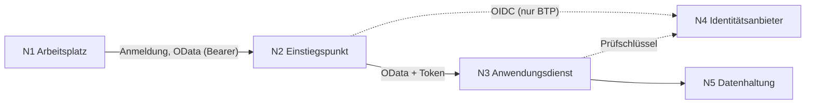

# ECM – Architekturbeschreibung nach NAF v4

NATO Architecture Framework v4, angewandt auf das ECM-System (Version 2.0). Die Sichten folgen dem NAF-v4-Raster
(Zeilen: Concepts **C**, Service Specifications **S**, Logical **L**, Physical Resource **P**, Architecture Meta-Data **A**).
Nicht genutzte Zellen sind am Ende aufgeführt. Detaillierte UML-Modelle: [uml.md](uml.md).

---

## A – Architecture Meta-Data

### A1 Meta-Data Definitions
| Feld | Wert |
|---|---|
| Name | ECM – Enterprise Content Management |
| Version | 2.0.0 (Release 2026-11) |
| Gegenstand | Mandantenfähiges Dokumentenmanagement mit Volltextsuche, Benachrichtigungen, Login per JWT bzw. SAP XSUAA |
| Zweck der Beschreibung | Grundlage für Betrieb, Sicherheitsbewertung und Weiterentwicklung (Skalierung, weitere Adapter) |
| Architekturstil | Hexagonal / Clean Architecture, Composition Root, Ports & Adapter |
| Notation | NAF v4 (Sichten), UML/Mermaid (Modelle), Markdown |

### A2 Architecture Products
| Produkt | Datei |
|---|---|
| Überblick, Betrieb, Konfiguration | `README.md` |
| UML-Modelle (Komponenten, Klassen, Sequenzen, Zustände) | `uml.md` |
| NAF-v4-Sichten | `nafv4.md` (dieses Dokument) |
| Approuter / XSUAA | `approuter/readme.md`, `approuter/xs-security.json`, `approuter/xs-app.json` |
| Deployment | `mta.yaml`, `deploy/compose.yaml`, `deploy/k8s/ecm.yaml`, `deploy/cloudfoundry/manifest.yml` |
| Schnittstelle | OData-v4-`$metadata` (`/odata/v4/ecm/$metadata`, Kopie in `frontend/localService/metadata.xml`) |

### A4 Methodology Used
Domänengetriebene Schichtung (Domain → Anwendungsfälle → Ports → Adapter), Abhängigkeiten nur nach innen.
Qualitätssicherung: D-`unittest`-Blöcke je Modul, Integrationstests (`backend/tests`), QUnit/OPA5 (`frontend/test`), Lasttest k6.

### A5 Architecture Status
| Bereich | Status |
|---|---|
| Fachfunktionen (Dokumente, Ordner, Suche, Arbeitsbereiche, Mandanten, Benachrichtigungen) | produktiv nutzbar |
| Authentifizierung JWT (Login, Refresh, Logout, Passwortänderung) | neu in 2.0, getestet |
| XSUAA/Approuter | neu in 2.0; Token-Prüfung durch Unit-Tests mit Stub abgedeckt, Ende-zu-Ende auf BTP noch nicht gemessen |
| Horizontale Skalierung des Backends | offen (Single-Writer-Journal, Sperrliste im Speicher) |

### A6 Architecture Versions
| Version | Änderungen |
|---|---|
| 1.x | OData-Backend `ecm.*`, proprietäres HMAC-Token, Frontend unter `frontend/webapp` |
| 2.0 | Paketstruktur `uim.ecm.*` nach Clean Architecture; JWT (HS256, Rotation, Refresh, Sperrliste); XSUAA (RS256); typisierte Konfiguration; Approuter + MTA; Login-Seite und Sitzungsmodell im Frontend; i18n en/de; Tests |

### A8 Standards
| Bereich | Standard |
|---|---|
| Token | RFC 7519 (JWT), RFC 7515 (JWS, HS256/RS256), RFC 6750 (Bearer), RFC 4648 (base64url) |
| Passwörter | PBKDF2-HMAC-SHA256 (RFC 8018), 210 000 Iterationen, 16-Byte-Salt |
| Schnittstelle | OASIS OData v4.0 (JSON-Format, `$metadata` CSDL XML) |
| Identität (BTP) | OAuth 2.0 / OpenID Connect über SAP XSUAA |
| UI | SAP Fiori 3 Design Guidelines, OpenUI5 1.136 |
| Betrieb | Prometheus Text Exposition Format, OCI-Container, MTA 3.2 |

---

## C – Concepts

### C1 Capability Taxonomy
```
ECM
├── C-1 Dokumente verwalten
│   ├── C-1.1 Dokumente anlegen, ändern, löschen
│   ├── C-1.2 Inhalte hoch-/herunterladen (gestreamt, revisioniert)
│   ├── C-1.3 Lebenszyklus (Entwurf → veröffentlicht → archiviert)
│   └── C-1.4 Ordnerstruktur je Arbeitsbereich
├── C-2 Informationen finden
│   ├── C-2.1 Volltextsuche (Name, Titel, Inhalt; Office/ODF/Text)
│   └── C-2.2 Filtern, Sortieren, Blättern (OData)
├── C-3 Zusammenarbeit
│   ├── C-3.1 Arbeitsbereiche und Mitgliedschaften
│   └── C-3.2 Benachrichtigungen
├── C-4 Mandanten und Benutzer verwalten
│   ├── C-4.1 Mandanten (Plattform)
│   └── C-4.2 Benutzer und Rollen (Mandant)
└── C-5 Identität und Zugriff sichern
    ├── C-5.1 Anmeldung mit Passwort (JWT)
    ├── C-5.2 Single Sign-on (SAP XSUAA)
    ├── C-5.3 Sitzungen verlängern, beenden, sperren
    └── C-5.4 Autorisierung (Mandantenisolation, Arbeitsbereichsrollen)
```

### C2 Enterprise Vision
Ein schlankes, selbst betreibbares Dokumentenmanagement, das sowohl eigenständig (Container, eigene Benutzer) als auch
als SAP-BTP-Anwendung mit Unternehmens-Login läuft. Fachlogik bleibt unabhängig von Infrastruktur, damit Speicher,
Suchindex und Identitätsanbieter ohne Eingriff in Domain und Anwendungsfälle ausgetauscht werden können.

### C3 Capability Dependencies
C-1, C-2 und C-3 setzen C-5 voraus (jeder Anwendungsfall erhält einen authentifizierten `Principal`).
C-2.1 hängt von C-1.2 ab (Textextraktion nach dem Upload). C-3.2 wird von C-1.3 und C-3.1 ausgelöst.
C-4.2 ist Voraussetzung für C-5.1; C-5.2 ersetzt C-4.2 teilweise (Benutzer werden aus XSUAA angelegt).

### C4 Standard Processes
| Prozess | Ablauf |
|---|---|
| Anmelden | Login-Seite → `POST /odata/auth/login` → JWT im Tab-Speicher → Hauptseite |
| Sitzung verlängern | 5 min vor Ablauf, nur bei Aktivität: `POST /odata/auth/refresh` (altes Token gesperrt) |
| Abmelden | Benutzermenü → `POST /odata/auth/logout` → Token gesperrt → Login-Seite |
| Dokument veröffentlichen | anlegen → Inhalt hochladen → veröffentlichen → Mitglieder werden benachrichtigt |
| Mandant aufnehmen | Plattform-Admin legt Mandant und dessen Admin an → Mandanten-Admin legt Arbeitsbereiche/Benutzer an |

### C8 Enterprise Vocabulary
| Begriff | Bedeutung |
|---|---|
| Mandant (Tenant) | organisatorische Einheit mit eigenen Benutzern und Arbeitsbereichen; strikt isoliert |
| Arbeitsbereich (Workspace) | Container für Ordner und Dokumente mit eigenen Mitgliedern |
| Principal | authentifizierter Aufrufer (Benutzer-ID, Name, Mandant, Rolle) |
| JWT | signiertes Zugriffstoken (Claims `sub`, `tid`, `role`, `exp`, `jti` …) |
| jti | eindeutige Token-ID; Grundlage der Sperrliste |
| Scope | XSUAA-Berechtigung (`Viewer`, `Editor`, `Admin`, `PlatformAdmin`) |
| Plattform-Admin | Benutzer ohne Mandant; verwaltet Mandanten, sieht keine Inhalte |

---

## S – Service Specifications

### S1 Service Taxonomy
| Service | Schnittstelle | Nutzer |
|---|---|---|
| S-Auth Authentifizierung | JSON/HTTP `/odata/auth/{login,refresh,logout,me,password,config}` | Frontend, Skripte |
| S-Doc Dokumentendienst | OData v4 `Documents`, `Folders`, `$value`, `ECM.Publish`, `ECM.Archive`, `$search` | Frontend, Integrationen |
| S-Ten Mandanten-/Arbeitsbereichsdienst | OData v4 `Tenants`, `Workspaces`, `Members`, `Users` | Admin-Oberfläche |
| S-Not Benachrichtigungsdienst | OData v4 `Notifications`, `MarkAllNotificationsRead` | Frontend |
| S-Ops Betriebsdienst | `/healthz`, `/metrics` (optional Bearer-geschützt) | Plattform, Monitoring |

### S3 Service Interfaces (Auszug)
| Operation | Eingabe | Ausgabe | Fehler |
|---|---|---|---|
| `login` | `Tenant`, `Username`, `Password` | `access_token`, `token_type`, `expires_in`, Benutzer, Mandant | 401 (verzögert), 403 (Modus `xsuaa`), 503 + `Retry-After` |
| `refresh` | Bearer (lokales JWT) | neues Token | 400 (XSUAA-Token), 401 |
| `logout` | Bearer | 204 | 401 |
| beliebige OData-Operation | Bearer (lokal oder XSUAA) | OData-JSON | 401, 403, 404 (auch für fremde Objekte), 409 |

### S4 Service Functions
S-Auth: Passwort prüfen → Token ausstellen → je Anfrage Token prüfen (Signatur, Algorithmus, `iss`, `aud`, Zeitfenster, Sperrliste)
→ Benutzer/Mandant aktiv? → aktuellen `Principal` liefern. Für XSUAA: RS256 prüfen → Scopes auswerten → Benutzer abbilden/anlegen.

### S8 Service Policies
- Jede Anfrage außer Health, Service-Dokument, `$metadata` und `auth/config` erfordert ein gültiges Bearer-Token.
- Maximal `ECM_MAX_CONCURRENT_LOGINS` Passwortprüfungen gleichzeitig; Fehlversuche werden um 500 ms verzögert.
- Seitengröße OData höchstens 1000 (`@odata.nextLink`); Login-Bodies höchstens 16 KiB; Uploads höchstens `ECM_MAX_UPLOAD_MB`.

---

## L – Logical

### L1 Node Types
| Knoten | Verantwortung |
|---|---|
| N1 Benutzer-Arbeitsplatz | Browser mit OpenUI5-Anwendung; hält das JWT pro Tab |
| N2 Einstiegspunkt | Approuter (BTP) bzw. nginx (Container): TLS, Routing, auf BTP XSUAA-Login und CSRF |
| N3 Anwendungsdienst | ECM-Backend: OData, Anwendungsfälle, Autorisierung, Token-Ausgabe |
| N4 Identitätsanbieter | SAP XSUAA (nur BTP) |
| N5 Datenhaltung | Journale (JSONL), Inhaltsdateien, Suchindex im Speicher |

### L2 Logical Scenario


### L3 Node Interactions
| Von → Nach | Inhalt | Sicherheit |
|---|---|---|
| N1 → N2 | UI-Ressourcen, OData-JSON, Inhalte | TLS; Bearer-JWT bzw. Session-Cookie + CSRF-Token |
| N2 → N3 | OData, Login | TLS (BTP-intern), weitergeleitetes XSUAA-JWT |
| N3 → N4 | – (nur Konfiguration: `verificationkey` aus `VCAP_SERVICES`) | – |
| N3 → N5 | Lesen/Schreiben von Journalen und Dateien | lokales Dateisystem/Volume |

### L4 Logical Activities
Anmelden (C-5.1/5.2) · Token prüfen (C-5.4) · Dokument anlegen/hochladen/veröffentlichen (C-1) · Text extrahieren und indizieren (C-2.1, im Hintergrund)
· Suchen (C-2) · Mitglieder verwalten (C-3.1) · Ereignisse verteilen (C-3.2, im Hintergrund) · Mandanten/Benutzer verwalten (C-4).

### L5 Logical States
Dokument: `Draft → Published → Archived` (archiviert = schreibgeschützt). Sitzung: `Restoring → SignedIn ⇄ (Refresh) → SignedOut`.
Token: `ausgestellt → gültig → (gesperrt | abgelaufen)`. Diagramme: `uml.md` Abschnitte 9 und 10.

### L7 Logical Data Model
Entitäten `Tenant`, `Workspace`, `Membership`, `User`, `Folder`, `Document`, `Notification`; Wertobjekt `Principal`;
Aufzählungen `Role`, `DocumentStatus`. Beziehungen und Attribute: `uml.md` Abschnitt 3; Schnittstellenmodell: OData-`$metadata`.

### L8 Logical Constraints
- **Mandantenisolation**: Jeder Zugriff prüft den Mandanten des `Principal`; fremde Objekte erscheinen als „nicht gefunden“.
- **Rollen**: effektive Rolle = min(Kontorolle, Mitgliedsrolle); Mandanten-Admins sind in ihren Arbeitsbereichen Admin.
- **Letzter Admin** je Mandant/Plattform kann nicht gelöscht, deaktiviert oder herabgestuft werden.
- **Token**: nur `HS256` mit konfiguriertem Schlüssel bzw. `RS256` mit XSUAA-Schlüssel; Lebensdauer ≤ `ECM_JWT_TTL_MINUTES`;
  Refresh ist einmalig; Rolle und Aktivstatus werden bei jeder Anfrage neu gelesen.
- **Passwörter** ≥ 8 Zeichen; XSUAA-Benutzer haben kein lokales Passwort.

---

## P – Physical Resource

### P1 Resource Types
| Ressource | Technologie |
|---|---|
| R1 Backend-Prozess | D (dmd/ldc2), vibe.d 0.10.5, uim-framework 26.11.2, OpenSSL (libcrypto) |
| R2 Frontend | OpenUI5 1.136 (CDN), statische Dateien |
| R3 Approuter | Node.js ≥ 20, `@sap/approuter` |
| R4 Webserver (Container-Variante) | nginx-unprivileged 1.27 |
| R5 Identitätsdienst | SAP XSUAA (Plan `application`) |
| R6 Speicher | Volume/PVC (Journale, Inhalte) |

### P2 Resource Structure (Backend)
```
app.d ── composition.d (Application)
          ├── presentation: AuthController, HealthController, ODataController   (je Worker-Thread ein Router)
          ├── application:  DocumentService, AuthService, TenancyService, NotificationService, AccessPolicy
          ├── infrastructure: JwtTokenService, XsuaaTokenValidator, Pbkdf2PasswordHasher, ThreadPoolExecutor, …
          └── persistence: Journaled*Repository, FileContentStore, InMemorySearchIndex, InMemoryTokenRevocationStore
```
Ein Prozess, N Worker-Threads (je eigener Event-Loop und Listen-Socket, `SO_REUSEPORT`), gemeinsame thread-sichere Dienste.

### P3 Resource Connectivity
| Variante | Pfad |
|---|---|
| SAP BTP | Browser ⇄ Approuter (HTTPS) ⇄ Backend (Destination `ecm-backend`, `forwardAuthToken`) ; Approuter ⇄ XSUAA |
| Container/K8s | Browser ⇄ nginx (`/odata/` → `BACKEND_URL`) ⇄ Backend |
| Standalone | Browser ⇄ Backend (`ECM_FRONTEND_DIR`) |

### P4 Resource Functions
| Funktion | Ressource / Modul |
|---|---|
| JWT ausstellen/prüfen | R1 `infrastructure/security/jwttokenservice.d` |
| XSUAA-JWT prüfen | R1 `infrastructure/security/xsuaavalidator.d` (OpenSSL `EVP_DigestVerify`) |
| Passwort-Hash | R1 `infrastructure/security/passwordhasher.d` (OpenSSL `PKCS5_PBKDF2_HMAC`) |
| Token-Sperrliste | R1 `persistence/storages/tokenrevocation.d` |
| Sitzung im Browser | R2 `model/session.js` |
| Login, Routen-Schutz | R2 `controller/Login.controller.js`, `Component.js`, `Main.controller.js` |
| SSO, CSRF | R3 `xs-app.json` |

### P5 Resource States
Backend: Start → Bootstrap (erster Admin) → Reindex im Hintergrund → bereit (`/healthz` = ok) → Shutdown (Hintergrundjobs leeren, Journale schreiben).

### P8 Resource Constraints
| Thema | Vorgabe |
|---|---|
| Schlüssel | `ECM_JWT_SECRET` ≥ 32 Zeichen, nur über Secret/`cf set-env`/user-provided Service; nie in `mta.yaml` oder Git |
| Lokale Geheimnisse | `approuter/default-env.json` steht in `.gitignore` |
| Skalierung | genau eine Backend-Instanz (Journal, Sperrliste, Suchindex im Prozess) |
| Ressourcen | Backend 1 GiB RAM (BTP), `ulimit -n` ≥ 65536, schneller lokaler Speicher |
| Metriken | `/metrics` nicht öffentlich exponieren oder `ECM_METRICS_TOKEN` setzen |

---

## Sicherheitsbetrachtung (Querschnitt)

| Bedrohung | Maßnahme |
|---|---|
| Token-Fälschung, `alg: none`, Algorithmus-Verwechslung | festes `alg` je Pfad (HS256 lokal, RS256 XSUAA), Signaturprüfung in konstanter Zeit |
| Token-Diebstahl | kurze Lebensdauer, Speicherung pro Tab (`sessionStorage`), Logout/Refresh sperren `jti`, Rechteprüfung bei jeder Anfrage |
| Brute Force | 500 ms Verzögerung, Login-Nebenläufigkeit begrenzt, PBKDF2 mit 210 000 Iterationen, gleiche Laufzeit für unbekannte Benutzer |
| Mandantenübergreifender Zugriff | `AccessPolicy` im Anwendungskern, „nicht gefunden“ statt „verboten“, Suchindex nach Mandant gefiltert |
| CSRF (BTP, Cookie-Sitzung) | Approuter `csrfProtection`, Frontend holt `X-CSRF-Token` |
| Clickjacking / MIME-Sniffing | `X-Frame-Options: DENY`, `X-Content-Type-Options: nosniff`, `Referrer-Policy: no-referrer` für API-Antworten |
| Schlüsselwechsel | `kid` + `ECM_JWT_PREVIOUS_SECRETS` |

**Restrisiken**: Sperrliste geht beim Neustart verloren (abgemeldete Tokens bis zu ihrem Ablauf wieder gültig); ein JWT im
`sessionStorage` ist bei XSS auslesbar (Gegenmaßnahme: CSP am Einstiegspunkt, keine Fremdskripte außer OpenUI5-CDN).

---

## Nicht ausgearbeitete NAF-Zellen
C5 (Effects), C7 (Performance Parameters – siehe README „Skalierung“), S2/S5/S6/S7, L6 (Logical Sequence – siehe `uml.md` 6–8),
P6 (Resource Sequence), P7 (Physical Data Model – JSONL-Journale je Entität), Lr (Lines of Development), A3, A7.
