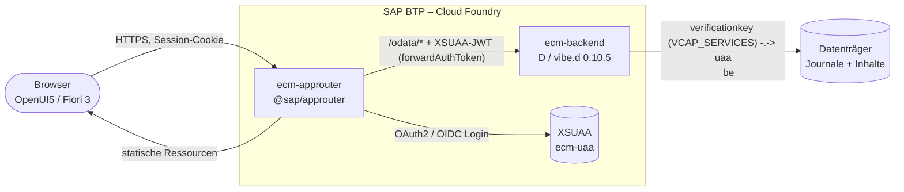
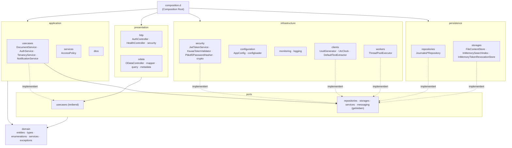
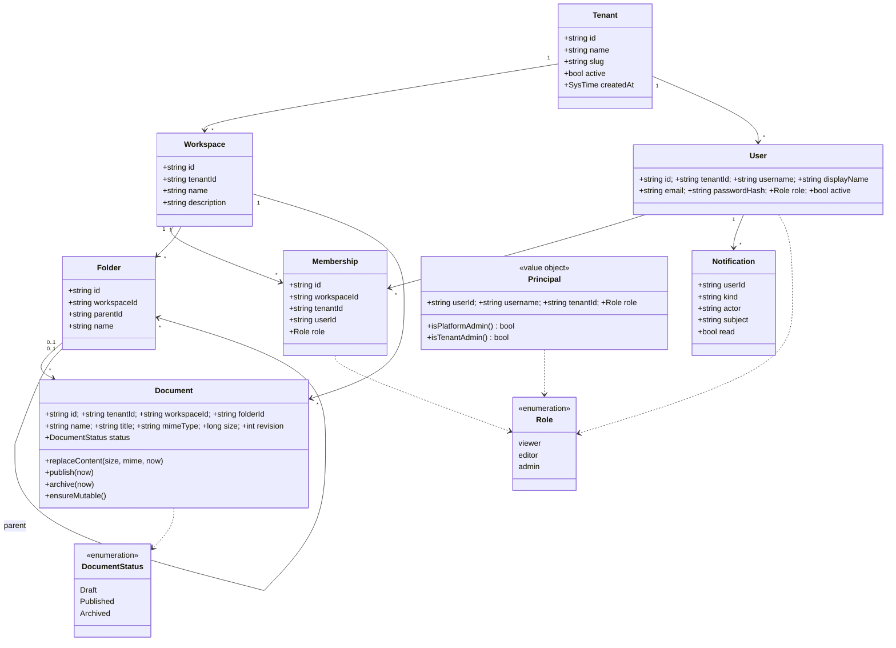
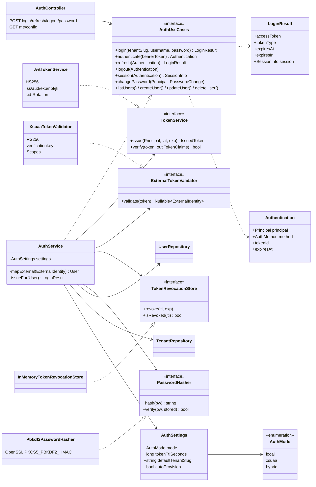
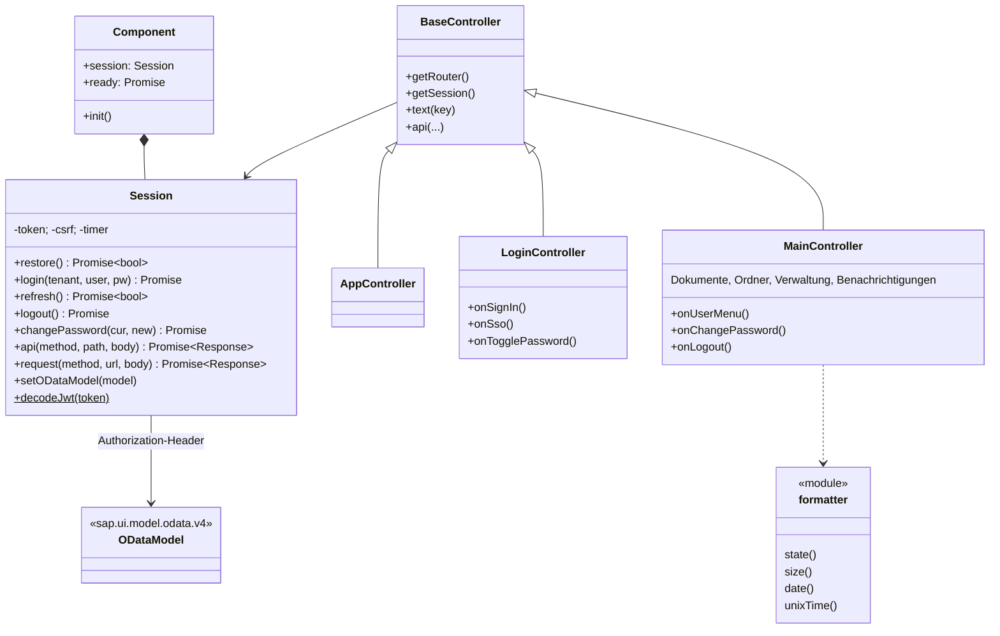
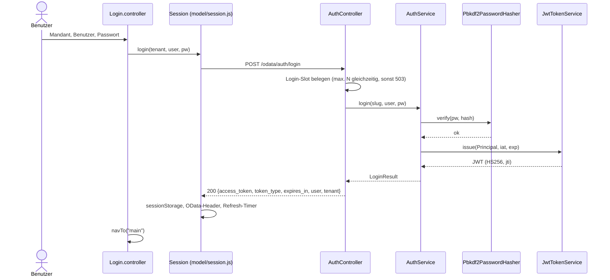
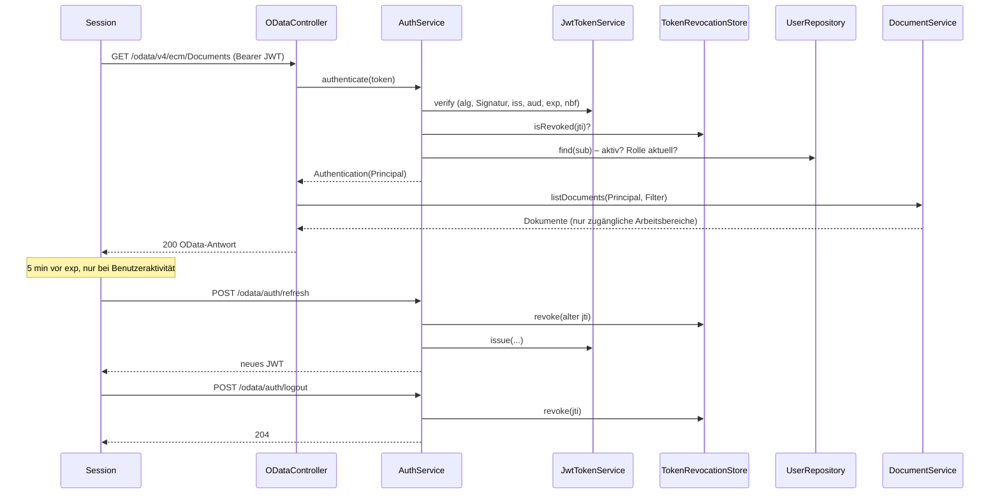
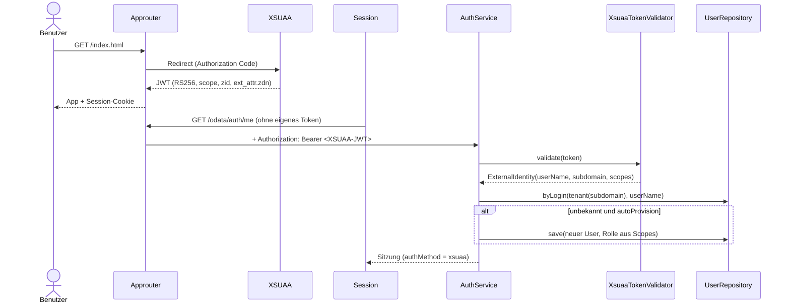
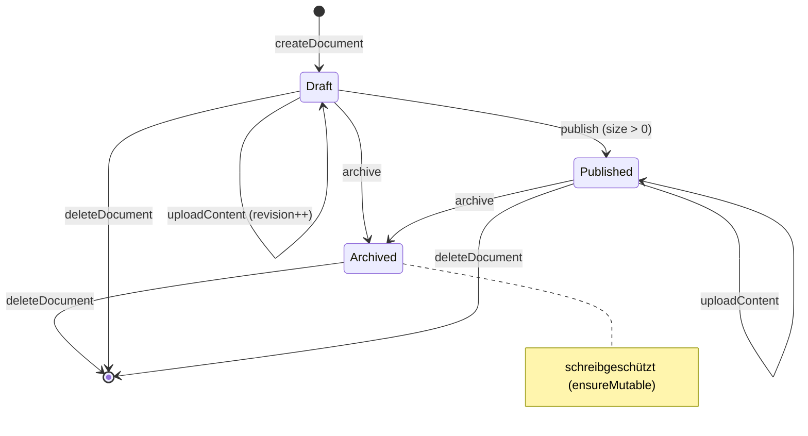
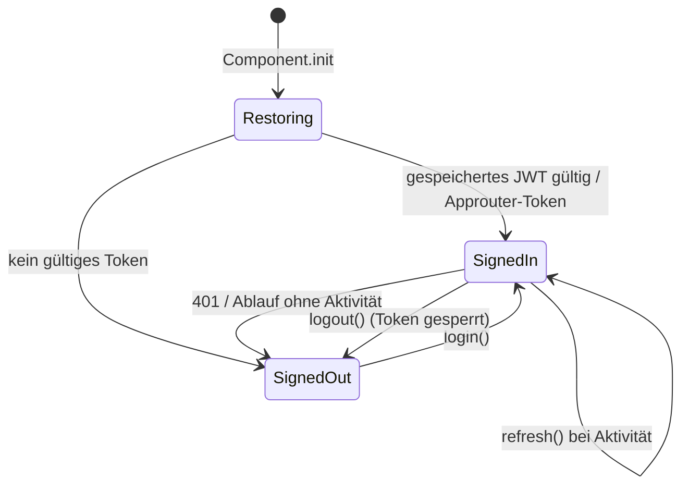

# ECM – UML-Modell

Diagramme in Mermaid (GitHub, VS Code und GitLab rendern sie direkt). Stand: Version 2.0 (JWT, XSUAA, Clean Architecture).

## 1. Komponentendiagramm (Einsatz auf SAP BTP)

Standalone/Container: Browser → nginx (oder `ECM_FRONTEND_DIR` im Backend) → Backend; Anmeldung über die Login-Seite mit eigenem JWT.

## 2. Schichten und Pakete (Backend)

## 3. Klassendiagramm – Domain

## 4. Klassendiagramm – Authentifizierung (Ports und Adapter)

## 5. Klassendiagramm – Frontend

## 6. Sequenz – Login mit Passwort (lokales JWT)

## 7. Sequenz – Anfrage mit JWT, Refresh und Logout

## 8. Sequenz – Single Sign-on über Approuter (XSUAA)

## 9. Zustandsdiagramm – Dokument

## 10. Zustandsdiagramm – Sitzung (Frontend)

